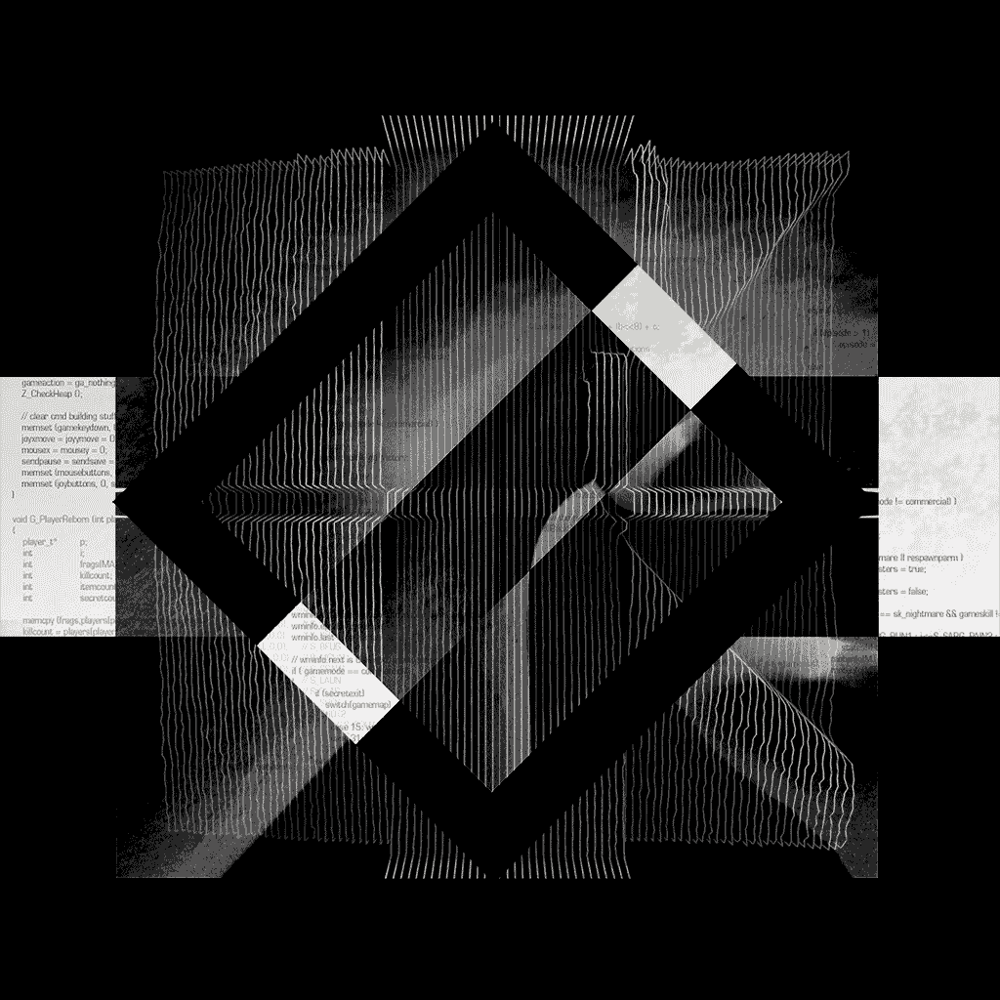

  

<h1 align="center">Hi, I'm Prasad Arote 👋</h1>

  <b>CSE AIML Student | Aspiring Software Developer</b>

I'm a Computer Science student specializing in Artificial Intelligence and Machine Learning, interested in building practical software solutions and exploring open-source technologies.

I believe in learning by building, experimenting, and collaborating.

---

### About Me

- 🎓 Pursuing Computer Science Engineering (AIML)
- 💻 Interested in Software Development and Artificial Intelligence
- 🌱 Currently strengthening my skills in programming and problem-solving
- 🔍 Exploring open-source projects and contribution opportunities
- 🚀 Working towards building meaningful real-world projects

---

### Tech Stack

**Programming Languages**

**Tools & Technologies**

---

### Currently Exploring

- Open-source development
- Artificial Intelligence and Machine Learning
- Data Structures and Algorithms
- Collaborative software development

---
### Connect With Me

---

*Always learning. Always building. Always improving.*
